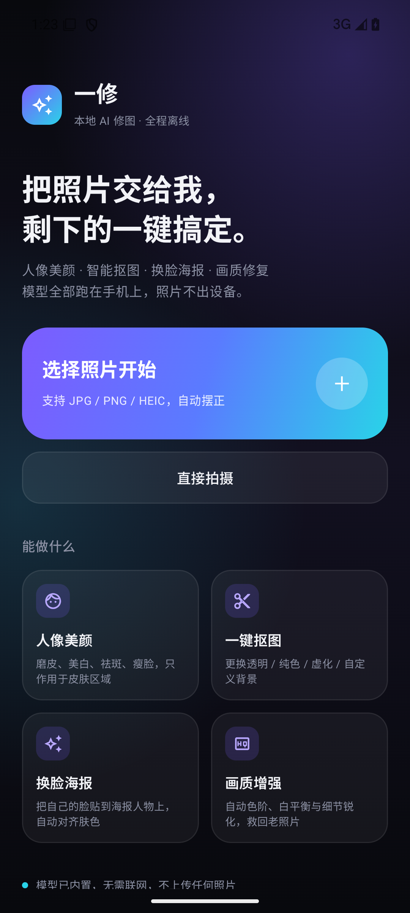

# 一修 · 本地 AI 修图（Android）

一款完全离线的 Android AI 修图应用。所有 AI 模型内置在 APK 中，照片不出设备、无需联网、无需任何 API Key。



## 功能

| 工具 | 说明 | 技术方案 |
|---|---|---|
| 🪄 智能增强 | 一键自动色阶 + 白平衡 + 轻锐化，救欠曝/发灰照片 | 直方图分析 + 曲线 |
| 🎨 滤镜 | 14 款预设（清透/奶油/胶片/赛博/落日…），实时缩略图预览 | 3x3 色彩矩阵 + 通道 LUT |
| 🎚 调色 | 亮度/对比/饱和/色温/锐化/暗角，多线程像素管线 | 自研渲染管线（并行计算） |
| 😊 人像美颜 | 磨皮、美白、祛斑、瘦脸，只作用于人脸皮肤区域 | ML Kit 人脸检测 + 皮肤蒙版 |
| ✂️ 一键抠图 | 背景替换：透明 / 纯色 / 虚化 / 自定义图片，保留发丝边缘 | MediaPipe Selfie Multiclass 分割（TFLite，内置） |
| 🎭 换脸海报 | 把自拍照的脸自动贴到海报人物脸上：五官对齐 + 肤色匹配 + 羽化融合 | ML Kit 关键点 + 仿射变换 + 颜色迁移 |
| 🌾 裁剪旋转 | 自由裁剪（拖拽角点）、1:1 / 4:5 / 3:4 / 16:9 比例、旋转 90°、镜像 | 自绘裁剪框 |
| ✏️ 文字 / 贴纸 | 多行文字、6 色预设、拖拽定位、缩放；20 款 emoji 贴纸 | Canvas 绘制 |
| ↩️ 撤销/重做 | 全操作历史，长按「对比」查看原图 | 快照栈 |
| 💾 保存导出 | JPEG/PNG 存入相册 `Pictures/一修/`；支持从其他应用「分享到一修」 | MediaStore |
| 🔄 自动更新 | 启动静默检查、应用内下载安装、断点续传、SHA-256 校验 | GitHub 清单 + 多镜像 |

## 自动更新

应用内置更新机制（参考 tv-player 的方案适配 Compose）：

- **检查**：启动时静默请求 `update/app-version.json`（GitHub raw + gh-proxy / ghfast / jsdelivr 多镜像并发取最快）；也可在首页底部「检查更新」手动触发
- **下载**：OkHttp 下载到缓存目录，支持 **Range 断点续传**；退到后台由前台服务（dataSync）保活，进度走通知栏
- **校验**：SHA-256 与清单比对，不符即丢弃；Android 系统还会拒绝非同签名安装，双重防篡改
- **安装**：FileProvider 拉起系统安装器，无「安装未知应用」权限时引导授权后自动继续
- 「忽略此版本」记录在本地，之后自动检查不再打扰（force 版本除外）

### 发版流程

全本地完成，不需要 CI、不需要上传密钥：

```bash
# 1. 改 version.properties 的 versionName / versionCode（versionCode 必须比上一个大）
# 2. 在 CHANGELOG.md 顶部写这一版改了什么
# 3. 打包并放进 dist/
./gradlew assembleRelease
cp app/build/outputs/apk/release/app-release.apk dist/photoai-<版本>.apk

# 4. 生成更新清单（自动写入地址、SHA-256、体积），再把 notes 改成 CHANGELOG 里的摘要
./scripts/publish-update.sh <版本> <versionCode> \
  https://raw.githubusercontent.com/ai2tool/photoai/main/dist/photoai-<版本>.apk \
  dist/photoai-<版本>.apk

# 5. 提交推送（可选打个 tag 做标记）
git add -A && git commit -m "Release v<版本>" && git tag v<版本> && git push origin main --tags
```

签名用本机 `~/.android/debug.keystore`，跨版本保持一致，所以老用户能直接覆盖升级；要换密钥就设置 `KEYSTORE_PATH` / `KEYSTORE_PASSWORD` / `KEYSTORE_ALIAS` / `KEY_PASSWORD` 环境变量再打包（换密钥后老版本需卸载重装）。

历史版本见 [CHANGELOG.md](CHANGELOG.md)，安装包见 [`dist/`](dist/)。

测试更新流程可指向任意 HTTP 源：`./gradlew assembleDebug -PupdateBase=http://10.0.2.2:8000`。

## 安装

直接安装 `dist/photoai-1.2.1.apk`（约 68MB，已签名）：

```bash
adb install dist/photoai-1.2.1.apk
```

要求 Android 8.0（API 26）及以上，arm64 / armv7 设备或模拟器。

## 从源码构建

```bash
# 需要 JDK 17+，Android SDK（compileSdk 35）
# local.properties 中配置 sdk.dir（首次构建会自动生成，见下）
./gradlew assembleRelease
```

- 技术栈：Kotlin + Jetpack Compose (Material 3)，无第三方 UI 库
- AI 依赖：`com.google.mediapipe:tasks-vision:0.10.14`、`com.google.mlkit:face-detection:16.1.7`
- 分割模型 `app/src/main/assets/selfie_multiclass.tflite`（16MB，来自 MediaPipe 官方模型库）

## 项目结构

```
app/src/main/java/com/yixiu/photo/
├── MainActivity.kt            # 入口、相册/拍照/分享三种进入方式
├── editor/
│   ├── EditorState.kt         # 参数模型 + 渲染管线（滤镜/蒙版/贴字）
│   └── EditorViewModel.kt     # 状态机、分级缓存、历史记录、导出
├── image/
│   ├── BitmapUtils.kt         # 加载(EXIF 摆正)/缩放/裁剪/保存
│   ├── ImageOps.kt            # 多线程像素引擎：LUT 调色、模糊、锐化、自动增强
│   └── AiOps.kt               # ML Kit 人脸、MediaPipe 分割、美颜、换脸、背景合成
├── update/
│   ├── AppUpdate.kt           # 清单检查(多镜像)、断点续传下载、SHA-256 校验、安装
│   ├── UpdateManager.kt       # 更新状态机（Compose 状态）+ 通知
│   └── UpdateService.kt       # 下载期前台服务（后台保活）
└── ui/
    ├── HomeScreen.kt          # 首页
    ├── EditorScreen.kt        # 编辑器主界面 + 工具栏
    ├── Panels.kt              # 各工具面板（滑杆/滤镜/抠图/换脸…）
    ├── CropDialog.kt          # 裁剪全屏对话框
    └── Theme.kt               # 暗色主题
dist/                       # 发布用 APK（由本地打包拷入）
update/app-version.json     # 自动更新清单（地址 / SHA-256 / 体积 / 更新说明）
version.properties          # 版本号唯一来源
CHANGELOG.md                # 各版本更新日志
```

## 性能说明

- 预览渲染限制在 1280px 长边 + 美颜/调色分级缓存，滑杆拖动实时反馈
- 导出时长边上限 3000px，全流程并行计算
- 所有模型推理跑在 CPU（XNNPACK 加速），不依赖 NPU，兼容所有机型

## 已验证（emulator API 35 实测）

- ✅ 人脸识别、美颜磨皮/美白（像素级 diff 确认生效）
- ✅ 抠图虚化背景（人物清晰、背景 bokeh）
- ✅ 换脸海报（五官对齐、肤色匹配、无硬边）
- ✅ 滤镜缩略图与一键保存到相册
- ✅ 拖拽裁剪 + 比例裁剪
- ✅ 自动更新全流程（本地 HTTP 源模拟）：启动自动弹窗 → 下载进度 → 后台下载+通知 → SHA-256 校验 → 拉起系统安装器 → 「忽略此版本」静默

更多截图见 `docs/`。
